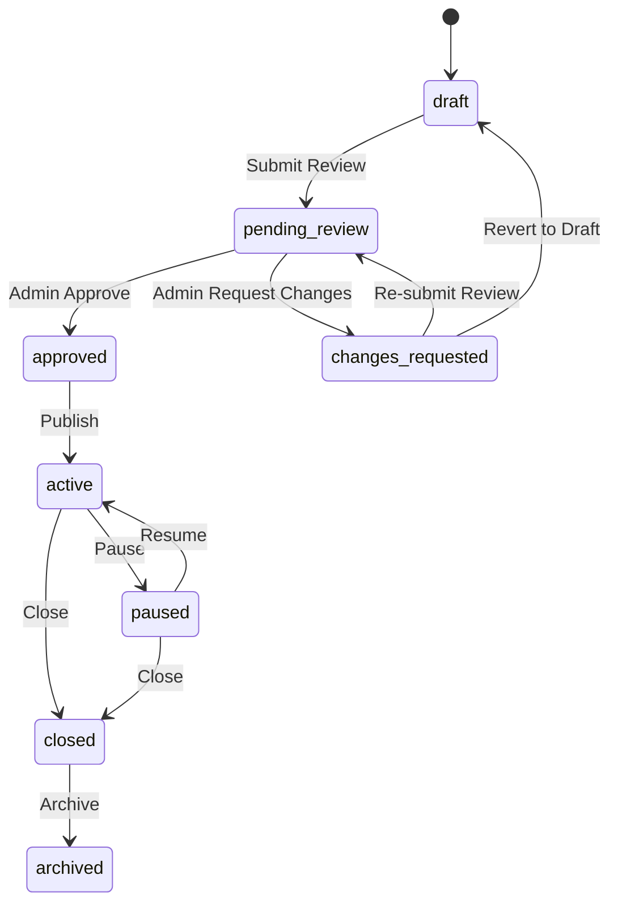

# Dialog API Enums & Constants Reference

This document lists every enum used across Dialog API requests and responses, valid values, their business meanings, and permitted status transitions.

---

## 1. Locales

### `PlatformLocale`
Supported platform-wide locales for user interfaces, survey contents, and metadata.
- **`uz`** – O‘zbekcha (Latin) *(Platform default)*
- **`ru`** – Русский
- **`en`** – English

---

## 2. Identity & Roles

### `PlatformRole`
Platform-level privileges assigned to users.
- **`user`** – Standard platform user (can be respondent or business owner/member).
- **`admin`** – Platform administrator with access to the moderation queue and administrative tools.

### `UserStatus`
- **`active`** – Normal active account.
- **`inactive`** – Suspended or disabled account (cannot log in; returns 403 `ACCOUNT_INACTIVE`).

### `OrganizationRole`
Role of a user within a specific business organization.
- **`owner`** – Organization creator/administrator; full access including deleting organization, member management, and survey control.
- **`manager`** – Organization manager; can manage surveys and view analytics.
- **`editor`** – Content editor; can edit draft surveys and manage pages/questions.
- **`analyst`** – Read-only analytics access to survey responses and exports.
- **`viewer`** – Read-only access to organization details.

### `OrganizationStatus`
- **`active`** – Normal operating organization.
- **`suspended`** – Temporarily deactivated by platform admin.

---

## 3. Survey Lifecycle & Builder

### `SurveyStatus`
Surveys follow a strict state machine.



| Status Value | Meaning | Editable? | Responses Accepted? |
|:---|:---|:---:|:---:|
| `draft` | Survey is in construction by organization members | ✅ Yes | ❌ No |
| `pending_review` | Submitted to admin moderation queue | ❌ No | ❌ No |
| `changes_requested`| Returned by moderator with feedback comments | ✅ Yes | ❌ No |
| `approved` | Moderation passed; ready for business to publish | ❌ No | ❌ No |
| `active` | Published live; respondents can answer | ❌ No | ✅ Yes |
| `paused` | Temporarily halted by business | ❌ No | ❌ No (only in-flight) |
| `closed` | Permanently closed to new responses | ❌ No | ❌ No |
| `archived` | Archived for historical analytics | ❌ No | ❌ No |

### `QuestionType`
Types of questions supported by the survey builder and respondent flow.
- **`single_choice`** – Single-select radio choice; requires at least 2 options.
- **`multiple_choice`** – Multi-select checkbox choice; options can be constrained by `min_choices` and `max_choices`.
- **`rating`** – Numeric scale rating; configured via `settings.min` and `settings.max` (e.g. 1 to 5).
- **`short_text`** – Single-line text input (up to 255 chars).
- **`long_text`** – Multi-line paragraph input (up to 5,000 chars).

---

## 4. Moderation

### `ModerationDecision`
Recorded on survey moderation history.
- **`pending`** – Awaiting moderator review.
- **`approved`** – Accepted by administrator.
- **`changes_requested`** – Rejected with specific reviewer feedback comments.

---

## 5. Respondent Participation

### `ParticipationStatus`
State of an individual respondent's session for a survey.
- **`in_progress`** – Respondent has started and answered some pages.
- **`completed`** – All pages submitted and participation finalized.
- **`abandoned`** – Participation timed out or expired without completion.

---

## 6. TypeScript Definition Template

```typescript
export type PlatformLocale = 'uz' | 'ru' | 'en';

export type PlatformRole = 'user' | 'admin';

export type UserStatus = 'active' | 'inactive';

export type OrganizationRole = 'owner' | 'manager' | 'editor' | 'analyst' | 'viewer';

export type SurveyStatus = 
  | 'draft'
  | 'pending_review'
  | 'changes_requested'
  | 'approved'
  | 'active'
  | 'paused'
  | 'closed'
  | 'archived';

export type QuestionType =
  | 'single_choice'
  | 'multiple_choice'
  | 'rating'
  | 'short_text'
  | 'long_text';

export type ParticipationStatus = 'in_progress' | 'completed' | 'abandoned';

export type ModerationDecision = 'pending' | 'approved' | 'changes_requested';
```
