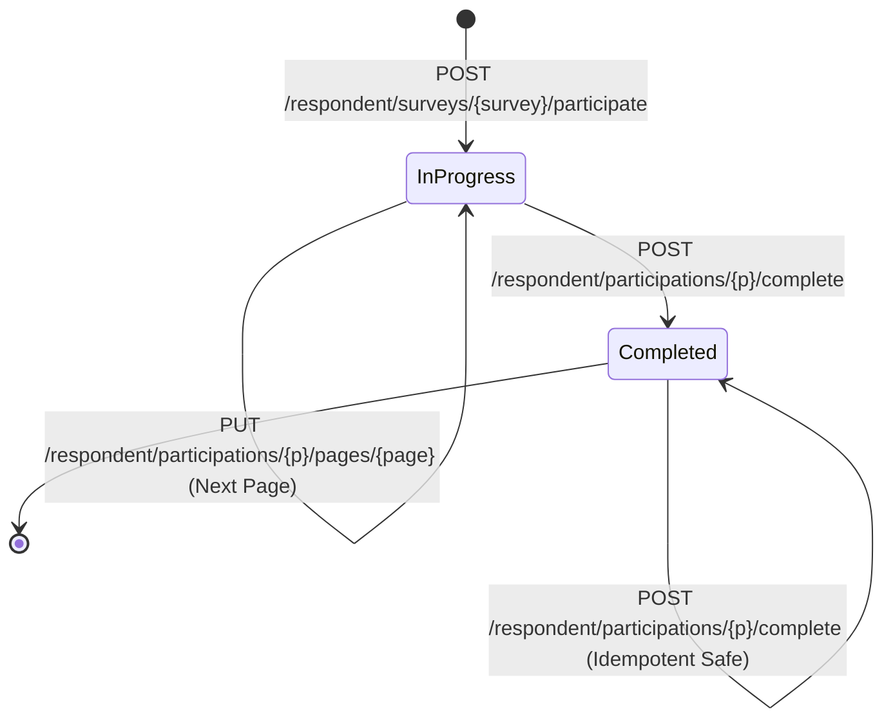

# Dialog Respondent Participation Flow

This guide explains the respondent participation lifecycle, payload structures, answer submission rules, and the contract for page navigation.

---

## 1. Core Architectural Principle: Backend Owns Navigation

> [!IMPORTANT]
> **The frontend client MUST NOT calculate or assume the next page.**
>
> The backend `SurveyFlow` engine controls page sequencing. Every answer submission returns the exact `current_step` containing the next page or completion trigger. The frontend simply renders whatever page object the backend provides.

---

## 2. Participation Lifecycle



### Participation Invariants:
1. **Single Participation Per User**: Database constraint `UNIQUE(survey_id, user_id)` guarantees one participation session per user per survey. Calling `participate` on an existing session safely resumes it.
2. **Survey Must Be Active**: Only surveys in `active` status accept participation. Inactive surveys reject with HTTP 422 `SURVEY_NOT_ACTIVE`.
3. **Draft Answers**: Answers on a page are upserted when submitted. A respondent can safely navigate away and resume later.
4. **Idempotent Completion**: Calling `POST .../complete` multiple times returns 200 OK without errors or double counting.

---

## 3. API Sequence

### Step 1: Start or Resume Participation
Endpoint: `POST /api/v1/respondent/surveys/{survey}/participate`
Request:
```json
{
  "locale": "uz"
}
```
Response:
```json
{
  "participation_id": 14,
  "status": "in_progress",
  "survey": {
    "id": 1,
    "title": "Mijozlar qoniqishi so‘rovi",
    "welcome_message": "Assalomu alaykum! So‘rovnomaga xush kelibsiz."
  },
  "current_step": {
    "page": {
      "id": 10,
      "title": "Xizmatlardan foydalanish",
      "position": 1,
      "questions": [
        {
          "id": 101,
          "type": "single_choice",
          "title": "Xizmatimizdan qanchalik tez-tez foydalanasiz?",
          "is_required": true,
          "position": 1,
          "options": [
            { "id": 501, "label": "Har kuni", "position": 1 },
            { "id": 502, "label": "Haftada bir necha marta", "position": 2 }
          ]
        },
        {
          "id": 102,
          "type": "short_text",
          "title": "Qo‘shimcha takliflaringiz",
          "is_required": false,
          "position": 2,
          "options": []
        }
      ]
    },
    "is_first_page": true,
    "is_last_page": false,
    "next": {
      "type": "page",
      "page_id": 11
    }
  }
}
```

---

### Step 2: Answer Submission Formats
Endpoint: `PUT /api/v1/respondent/participations/{participation}/pages/{page}`

The `answers` payload is an object keyed by question ID string. The value depends on question type:

| Question Type | Answer Payload Format | Example |
|:---|:---|:---|
| **`single_choice`** | `{"option_id": number}` | `{"101": {"option_id": 501}}` |
| **`multiple_choice`** | `{"option_ids": number[]}` | `{"103": {"option_ids": [503, 504]}}` |
| **`rating`** | `{"value": number}` | `{"104": {"value": 5}}` |
| **`short_text`** | `{"text": string}` | `{"102": {"text": "Ajoyib xizmat"}}` |
| **`long_text`** | `{"text": string}` | `{"105": {"text": "Batafsil sharh..."}}` |

#### Example Request:
```json
{
  "answers": {
    "101": {
      "option_id": 501
    },
    "102": {
      "text": "Ajoyib xizmat"
    }
  }
}
```

#### Response (Directs to Next Page):
```json
{
  "success": true,
  "current_step": {
    "page": {
      "id": 11,
      "title": "Baholash",
      "position": 2,
      "questions": [
        {
          "id": 104,
          "type": "rating",
          "title": "Xizmat sifatini baholang (1-5)",
          "is_required": true,
          "settings": { "min": 1, "max": 5 }
        }
      ]
    },
    "is_first_page": false,
    "is_last_page": true,
    "next": {
      "type": "complete"
    }
  }
}
```

---

### Step 3: Complete Participation
When `current_step.next.type === "complete"`, show the submission button. Upon clicking submit, call:

Endpoint: `POST /api/v1/respondent/participations/{participation}/complete`
Response:
```json
{
  "completed": true,
  "thank_you_message": "Fikringiz uchun tashakkur!"
}
```

Display `thank_you_message` to the respondent and navigate to the completion confirmation screen.
