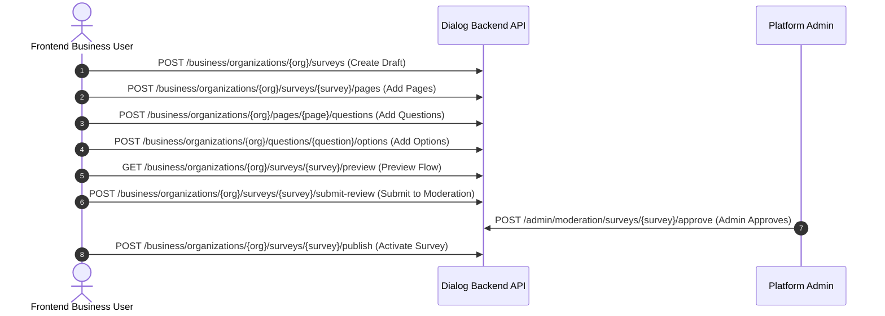

# Dialog Survey Builder Integration Guide

This guide walks through constructing and publishing a complete multi-language survey from the frontend survey builder UI.

---

## 1. Survey Builder Workflow Overview



---

## 2. Step-by-Step API Sequence

### Step 1: Create Draft Survey
Endpoint: `POST /api/v1/business/organizations/{organization}/surveys`
```json
{
  "default_locale": "uz",
  "locales": ["uz", "ru"],
  "title": {
    "uz": "Xaridlar bo‘yicha so‘rovnoma",
    "ru": "Опрос о покупках"
  },
  "description": {
    "uz": "Do‘konimiz xizmatini baholang",
    "ru": "Оцените наш магазин"
  }
}
```
*Note: The newly created survey is in `draft` status and already contains its first default page (`position = 1`).*

---

### Step 2: Manage Pages
#### Add an additional page:
Endpoint: `POST /api/v1/business/organizations/{organization}/surveys/{survey}/pages`
```json
{
  "title": {
    "uz": "Yakuniy baholash",
    "ru": "Итоговая оценка"
  }
}
```

#### Reorder pages:
Endpoint: `PUT /api/v1/business/organizations/{organization}/surveys/{survey}/pages/reorder`
```json
{
  "pages": [2, 1]
}
```

---

### Step 3: Add Questions
Endpoint: `POST /api/v1/business/organizations/{organization}/pages/{page}/questions`

#### Example A: Single Choice Question
```json
{
  "type": "single_choice",
  "title": {
    "uz": "Bizni do‘stlaringizga tavsiya qilasizmi?",
    "ru": "Порекомендуете ли нас друзьям?"
  },
  "is_required": true
}
```

#### Example B: Rating Question
```json
{
  "type": "rating",
  "title": {
    "uz": "Xizmat sifatini baholang (1-5)",
    "ru": "Оцените качество обслуживания (1-5)"
  },
  "is_required": true,
  "settings": {
    "min": 1,
    "max": 5
  }
}
```

#### Example C: Short Text Question
```json
{
  "type": "short_text",
  "title": {
    "uz": "Ismingiz yoki fikringiz",
    "ru": "Ваше имя или отзыв"
  },
  "is_required": false
}
```

#### Reorder questions:
Endpoint: `PUT /api/v1/business/organizations/{organization}/pages/{page}/questions/reorder`
```json
{
  "questions": [5, 4, 6]
}
```

#### Duplicate question:
Endpoint: `POST /api/v1/business/organizations/{organization}/questions/{question}/duplicate`
*Duplicates question, settings, and options at the end of the same page.*

---

### Step 4: Add Options for Choice Questions
Endpoint: `POST /api/v1/business/organizations/{organization}/questions/{question}/options`
```json
{
  "label": {
    "uz": "Albatta",
    "ru": "Конечно"
  }
}
```

#### Reorder options:
Endpoint: `PUT /api/v1/business/organizations/{organization}/questions/{question}/options/reorder`
```json
{
  "options": [12, 11]
}
```

---

### Step 5: Test & Preview (Stateless)
Optional MVP logic configuration: read or replace `GET/PUT /api/v1/business/organizations/{organization}/surveys/{survey}/logic` after creating pages/questions/options. See `API-SURVEY-LOGIC.md` for visibility, branching, early completion and AND/OR payloads. Rules share survey editability and become locked on review submission.

Before submitting, preview the survey flow in any supported language without polluting production response databases:
Endpoint: `GET /api/v1/business/organizations/{organization}/surveys/{survey}/preview?locale=uz`

To test validate respondent inputs on a specific page:
Supply `previous_answers` for earlier applicable pages when testing later conditional pages; preview creates no participation/answer records.
Endpoint: `POST /api/v1/business/organizations/{organization}/surveys/{survey}/preview/pages/{page}/validate`
```json
{
  "locale": "uz",
  "answers": {
    "1": 1
  }
}
```

---

### Step 6: Submit to Moderation
Endpoint: `POST /api/v1/business/organizations/{organization}/surveys/{survey}/submit-review`

Transitions survey status from `draft` to `pending_review`.
The survey is now locked from editing until moderation completes.
